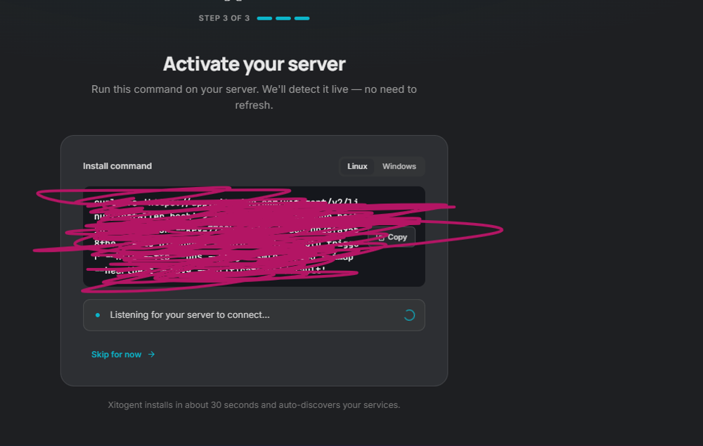
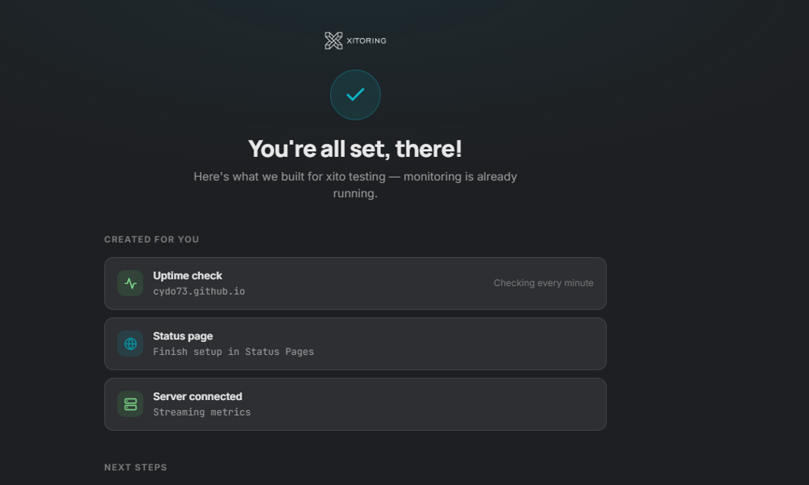
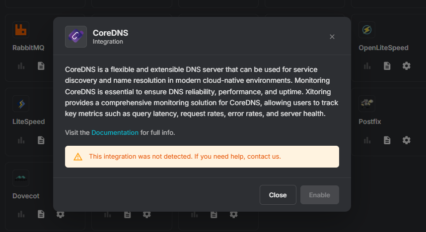
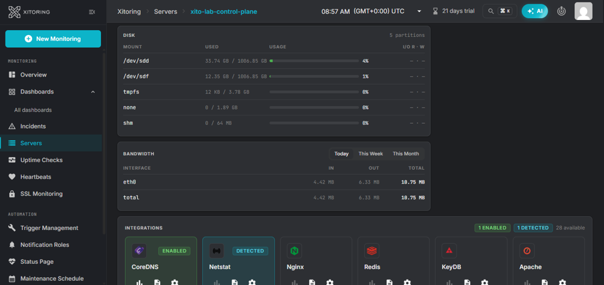
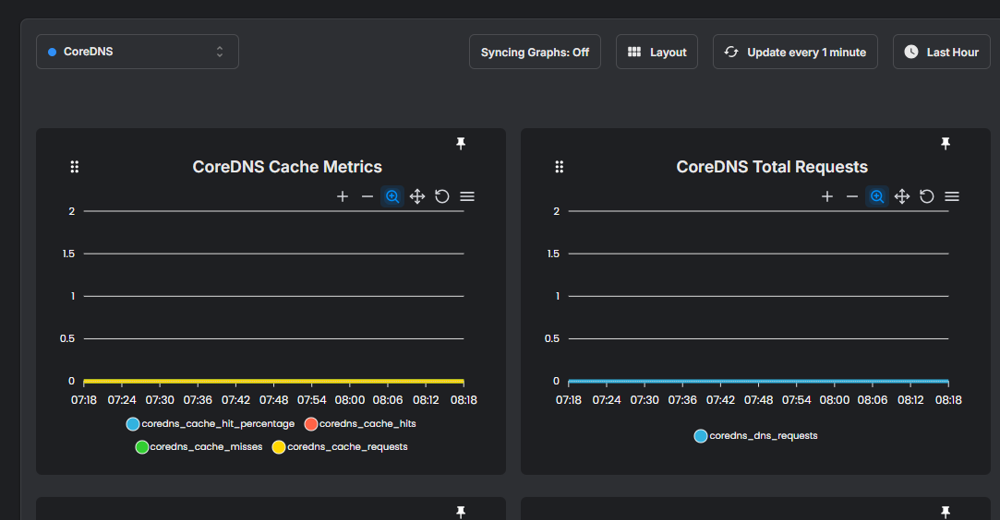
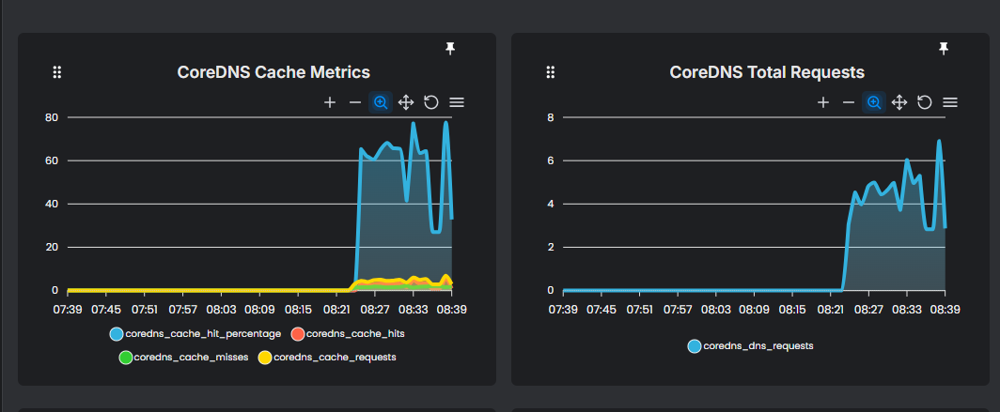
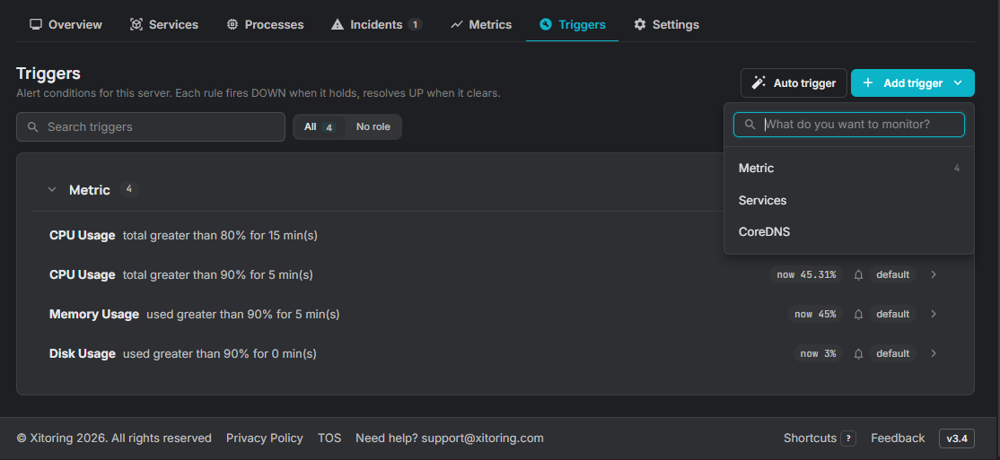
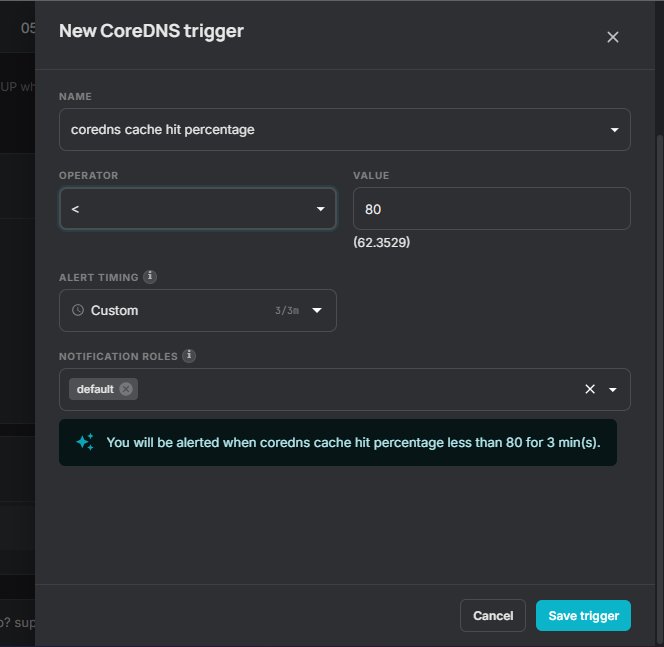
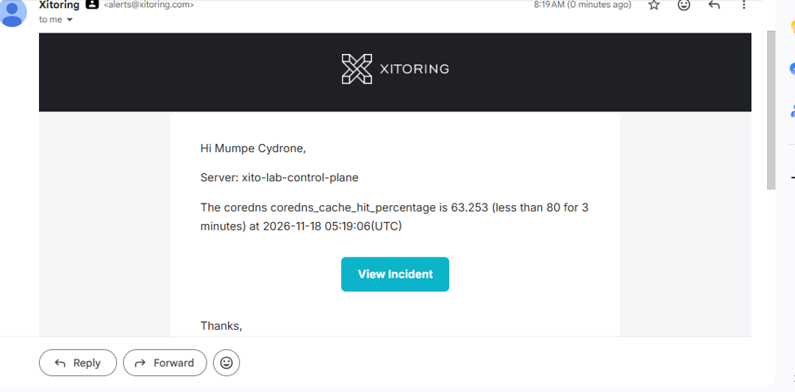
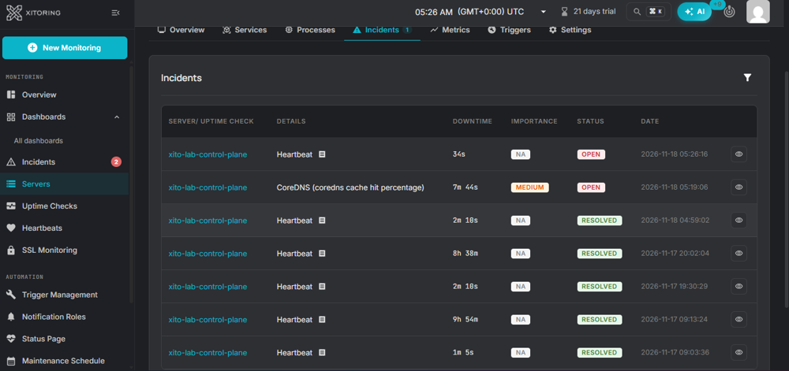

# Monitoring CoreDNS in Kubernetes with Xitoring

A tested walkthrough on a local kind cluster. This is an independent sample, not official Xitoring documentation. I followed it on 17 and 18 November 2026 and wrote down everything that got in my way.

Prefer pictures and a shorter read? An illustrated version of this write up lives in `index.html`, which GitHub Pages serves as the project page.

## What you will end up with

- A one node Kubernetes cluster on your laptop
- Xitogent sending CoreDNS metrics to your Xitoring dashboard
- An alert that fires when the DNS cache hit rate drops
- A look at what happens when CoreDNS disappears completely

## What I tested on

| Part | Version |
|---|---|
| Xitogent | 2.13 (from `xitogent version`) |
| CoreDNS | 1.11.1 (from the metrics endpoint) |
| Xitoring dashboard | v3.3 on 17 November, v3.4 on 18 November |
| Node operating system | Debian GNU/Linux 12 (bookworm), as shown in the dashboard |
| kind | v0.24.0 |
| Cluster | One control plane node |
| My machine | Windows, with Ubuntu on WSL and Docker Desktop |

All times below are UTC, because that is what Xitoring showed me.

## Before you start

You need Docker running, plus `kind` and `kubectl` installed. You also need a Xitoring account. I used the free trial. It comes with one notification role called `default`, so use that one. Trying to create a second role gave me a popup saying the maximum had been reached.

## Step 1: Create the cluster

```bash
kind create cluster --name xito-lab
kubectl get nodes
```

You should see one node called `xito-lab-control-plane` with the status Ready.

## Step 2: Install Xitogent inside the node

A kind node is just a Docker container, so you can step inside it and install the agent like you would on a server.

1. In Xitoring, choose **Monitor servers too**, fill in the short project form, and leave Linux selected. You will land on a screen called "Activate your server" with an install command and a line saying it is listening for your server.
2. Step into the node:

```bash
docker exec -it xito-lab-control-plane bash
```

3. My install failed at first with `bash: sudo: command not found`. The command from Xitoring starts with `sudo`, and the node image does not have it. Install it, along with curl:

```bash
apt-get update && apt-get install -y sudo curl
```

4. Copy the install command from the Xitoring screen and paste it into the node. It contains your key, so never paste it anywhere public.
5. After about a minute I saw "Installation Successful", and the Xitoring screen switched to "Server connected, Streaming metrics".




You can also check from inside the node:

```bash
xitogent version
ps aux | grep xitogent
```

The first prints the version. The second shows the agent running as a background daemon.

Note that I installed the agent inside the node itself because it is the simplest way to learn the flow. I have not tested running it as a DaemonSet.

## Step 3: Check CoreDNS is serving metrics

Open a second terminal on your own machine, outside the node, and find the DNS service address:

```bash
kubectl -n kube-system get svc kube-dns
```

Look at the CLUSTER-IP column. Mine was `10.96.0.10`. Now go back to the node terminal and test it:

```bash
curl -s http://10.96.0.10:9153/metrics | head -n 5
```

You should see lines starting with `# HELP`. The first metric is `coredns_build_info`, which is where I read the CoreDNS version.

## Step 4: Turn on the CoreDNS integration

In the dashboard, open your server, scroll to Integrations, and click the CoreDNS card. Mine said **This integration was not detected**, and the Enable button stayed greyed out.

That makes sense once you know where Xitogent looks. The docs expect CoreDNS metrics at localhost on the same server. In Kubernetes, CoreDNS runs in a pod, so nothing is listening on the node's own localhost. I did not test the default address from the command line, so I cannot say exactly how it would fail.



The command line lets you choose the address instead. In the node terminal:

```bash
xitogent integrate
```

Pick CoreDNS from the numbered list. It was number 26 in mine, but check yours. Then answer the prompts:

```
Enter CoreDNS metrics host (default: http://127.0.0.1): http://10.96.0.10
Enter CoreDNS metrics port (default: 9153): 9153
integration setup was successful and config file updated.
```

Use your own CLUSTER-IP from Step 3. The agent saves your answers in `/etc/xitogent/integrations/coredns_integration.conf`:

```
host=http://10.96.0.10
port=9153
enabled=true
```

Refresh the dashboard. The CoreDNS card should now say Enabled.



I restarted the agent once around this point with `systemctl restart xitogent`, so I cannot tell you whether that is required.

## Step 5: Give CoreDNS something to do

On my quiet cluster every CoreDNS graph was a flat line at zero. That is normal, because the counters only move when something asks a question. In the terminal outside the node, start a small pod that keeps doing lookups:

```bash
kubectl run dns-test --image=busybox:1.28 --restart=Never -- sh -c "while true; do nslookup kubernetes.default; nslookup example.com; sleep 1; done"
kubectl get pod dns-test
```

Wait for Running. In the dashboard, open your server, go to the **Metrics** tab, and choose **CoreDNS** from the dropdown at the top left. There are seven graphs: Cache Metrics, Total Requests, Request Types, Response Codes, Proxy Connection Cache, Network Bytes and Panics.

Within a few minutes the lines in Cache Metrics, Total Requests and the others climbed off zero. My cache hit percentage mostly sat between about 60 and 75, with the odd dip.




One graph stayed empty: **CoreDNS Network Bytes**, whose series are named `process_network_receive_bytes` and `process_network_transmit_bytes`. I searched the metrics endpoint for `process_network` and for lines starting with `process_`, and both came back empty on CoreDNS 1.11.1. I have not checked other versions.

## Step 6: Create an alert

1. Open your server and go to the **Triggers** tab.
2. Click **Add trigger** and choose **CoreDNS**.
3. The form opens with the name set to `coredns panics`, the operator `>` and the value 80. Do not save that as it is, because a panic count will never reach 80.
4. Change the name to `coredns cache hit percentage`, the operator to `<`, and keep the value at 80.
5. Leave Alert timing on its default, `Custom 3/3m`. The Incident Policy docs describe Custom mode as separate down and resolve tolerances, so I read it that way, but the form itself does not say.
6. Keep the `default` notification role. The form writes out the rule in plain words at the bottom, and it also shows the current reading under the value box. Mine was about 62.

I picked 80 because Xitoring's CoreDNS docs suggest it and my live reading was well below it, so the alert was certain to fire. For a real cluster, look at your own baseline first.




## Step 7: Watch it fire

I saved the trigger at about 05:15. An incident called "CoreDNS (coredns cache hit percentage)" opened at 05:19:06, rated Medium, and the email arrived in the same minute. It said the metric was 63.253, below 80 for 3 minutes.




## Step 8: Break CoreDNS on purpose

This is a throwaway cluster, so take CoreDNS away:

```bash
kubectl -n kube-system scale deployment coredns --replicas=0
```

A few minutes later a second incident opened, called Heartbeat, at 05:26:16. The email said some server integrations were not sending statistics. The first incident was still open at that point.

So you get two different signals. The threshold alert tells you CoreDNS is working badly. The heartbeat alert tells you the data stopped. I would keep both.

Now put everything back:

```bash
kubectl -n kube-system scale deployment coredns --replicas=2
kubectl delete pod dns-test
```

<!-- TODO before publishing: add what happened after restoring CoreDNS, including whether and when each incident resolved. -->

## Things you will notice inside a container

The docs do not mention containers, so here is what looked strange to me.

- The memory and disk figures on the server page look like the machine underneath, not a limit on the node. Mine showed 3.78 GB of memory and 1.97 TB of disk. I did not confirm where those numbers come from.
- The Services panel listed 49 services, and the first five I saw were marked dead: Auditd, Display Manager, Emergency, Initrd Cleanup and Initrd Parse Etc. Those are system services a kind node is not meant to run. I did not look at the other 44.

## Things that went wrong for me

| What I saw | What it was |
|---|---|
| `bash: sudo: command not found` | The node image has no sudo. Install it first, as in Step 2. |
| "This integration was not detected" | The dashboard looks for CoreDNS on the node's localhost. See Step 4. |
| `CoreDNS connection test failed: failed to connect to CoreDNS metrics endpoint` | I had typed `10.96.0.1`, one digit short, which is a different service. The error does not say which address it tried. Test with `curl` first, as in Step 3. |
| `ERR! command status not found` | Xitogent 2.13 does not have a `status` command. I used `xitogent version` and `ps aux | grep xitogent` instead. |
| Flat graphs | Nothing was asking CoreDNS questions yet. See Step 5. |
| An alert email I never set up | My laptop and wifi went off for several hours. Xitoring noticed the agent had gone quiet and emailed me, which tested the alert chain by accident. When the node came back, my `dns-test` pod showed Unknown, so I deleted and recreated it. |

## Clean up

```bash
kubectl delete pod dns-test --ignore-not-found
kind delete cluster --name xito-lab
```

Then delete the test server in Xitoring. Blur anything that looks like a key, ID or password before sharing screenshots, including alert emails.

## What I did not test

- Running Xitogent as a DaemonSet, which Xitoring's knowledge base article recommends for Kubernetes
- A cluster with more than one node
- Other CoreDNS versions
- Paid plan limits
